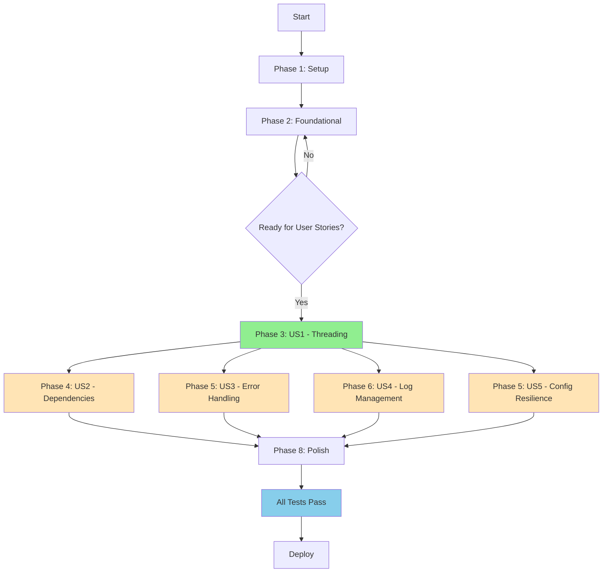
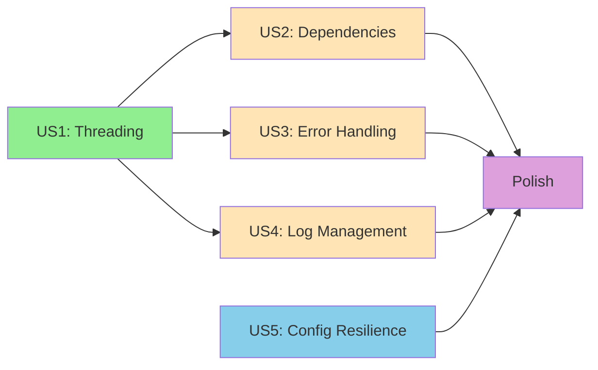
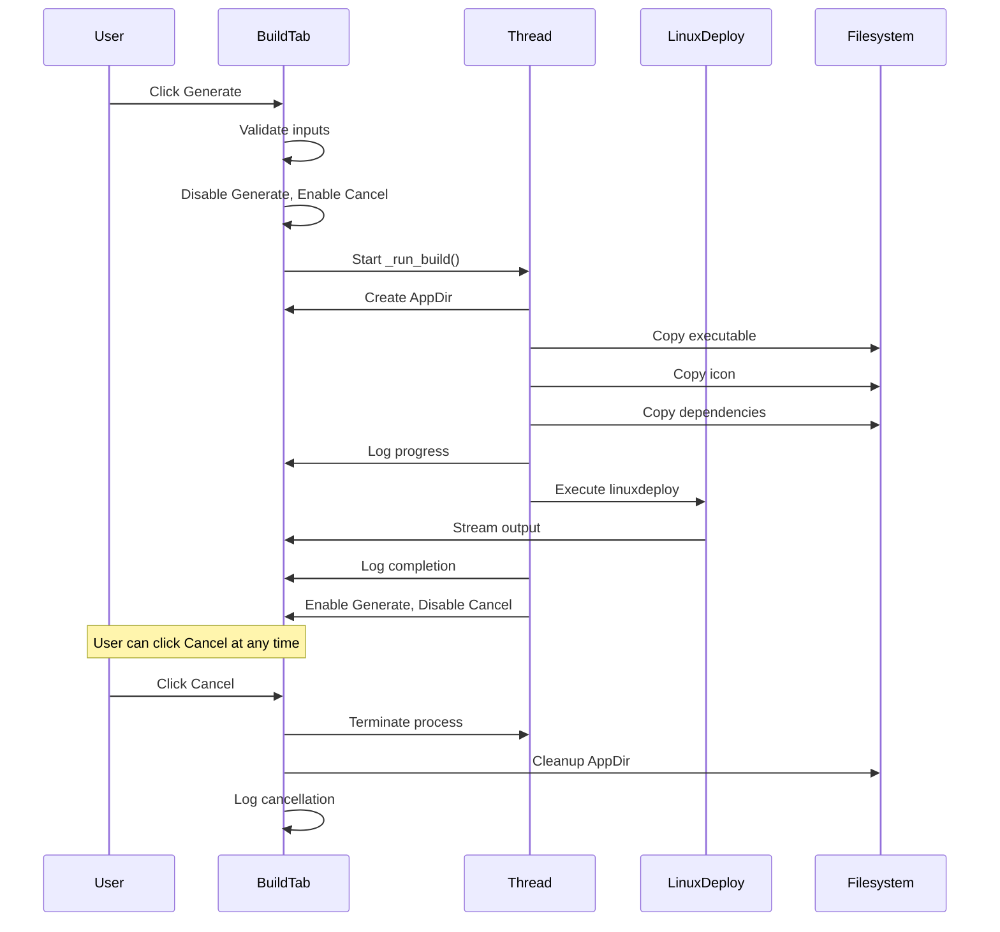
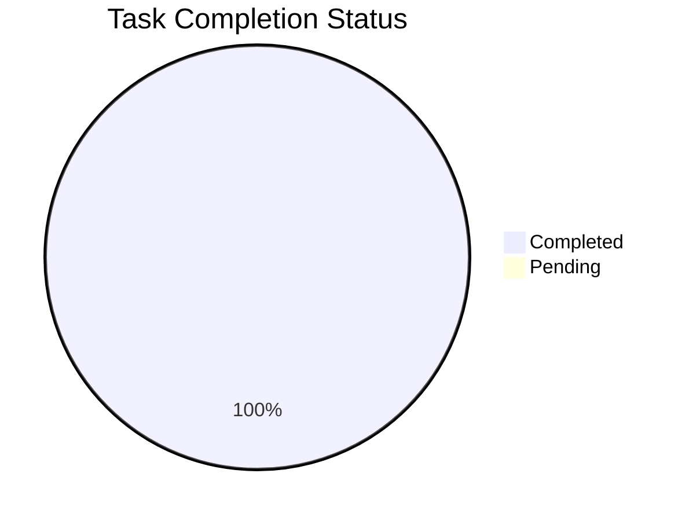
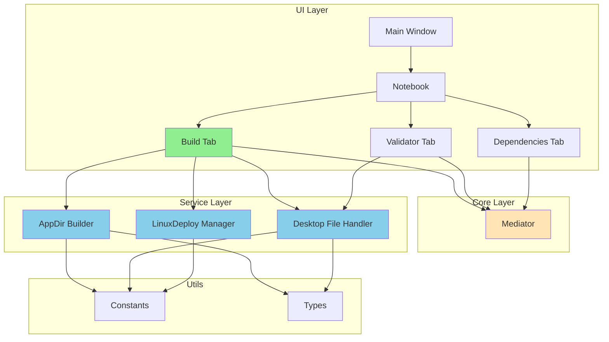

# AppImage Builder - Spec-Kit Flow Diagram

## Development Workflow

## User Story Dependencies

## Build Process Flow

## Task Status Summary

## Architecture Overview

## Key Metrics

| Metric | Before | After |
|--------|--------|-------|
| UI Freeze During Build | Yes (2+ min) | No |
| Cancel Support | None | 1 second |
| Dependencies Ignored | Yes | Included |
| Error Handling | Crashes | User Dialogs |
| Log Management | Manual | Auto-clear |
| Test Coverage | 44% | 100% |
| Test Failures | 5 | 0 |
